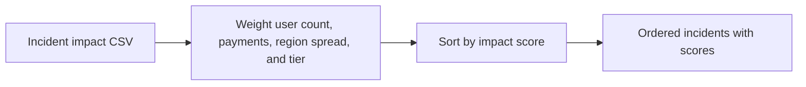

# Customer Impact Prioritizer

An incident commander needs a consistent way to order incidents by user impact, payment impact, region spread, and service tier.

## What I built

I built an incident ranking utility that scores affected-user counts, payment impact, regional spread, and service tier. It sorts incident rows by descending score so responders can explain the priority order.

## How it works



[Architecture](docs/ARCHITECTURE.md) · [Decision rules and source](docs/RULES.md)

## Tools used

| Tool | Role in this repository |
| --- | --- |
| Python | [impact_prioritizer.py](impact_prioritizer.py) implements the CLI and decision rules. Uses `csv` to read tabular exports. |
| Make | Runs the documented example and the local `unittest` suite. |
| Python replay runner | Compares actual stdout with the checked-in baseline fixtures. |
| Ruff and Bandit | Developer lint and static security checks through `make check`. |

## Run the project

Use Python 3.10+ and Make. From the repository root:

```sh
python3 impact_prioritizer.py sample_incidents.csv
```

Checkout card failures score 26 and rank ahead of photo upload retries at 1. [Full expected output](examples/Demo%201.stdout.txt)

### Additional replay cases

- **Last sample record in isolation** · `python3 impact_prioritizer.py examples/last-record.csv` · [Expected output](examples/Last%20sample%20record%20in%20isolation.stdout.txt)

## Verify the project

```sh
make verify
make replay
```

`make replay` checks the recorded cases and exits nonzero if the output changes.
See the [developer guide](docs/DEVELOPMENT.md) for the pinned lint and security tools.

## Operating limits

The ranking depends on trustworthy input counts and fixed weights. Deduplicate reports before summing or comparing impact.

[Case study](docs/CASE_STUDY.md) · [Operator runbook](docs/RUNBOOK.md) · [Verification report](reports/verification.md)
