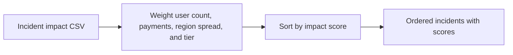

# Customer Impact Prioritizer architecture

Ranks incidents by affected users, payment impact, region spread, and service tier.

## Operational boundaries

The documented run evaluates the bundled sample locally. Results depend on the quality and scope of the input. The demo makes no live infrastructure changes.
